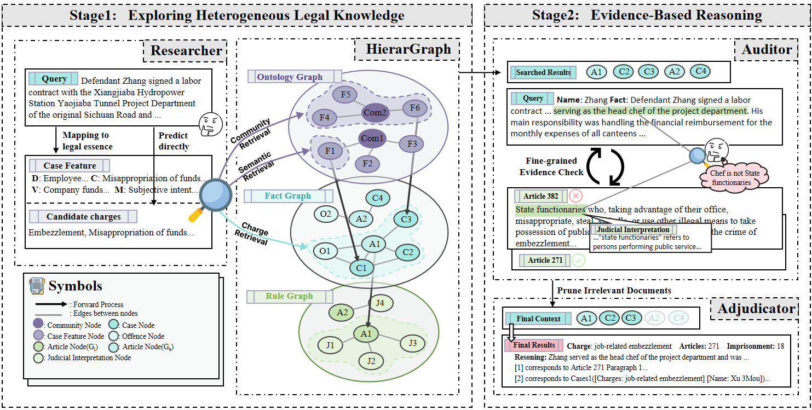

# **LegalGraphRAG: Multi-Agent Graph Retrieval-Augmented Generation for Reliable Legal Reasoning**

> An evaluation framework for legal judgment prediction that integrates multi-agent graph retrieval and provides a reproducible main-experiment pipeline for LegalGraphRAG.

<!-- <p align="center">
  <a href="https://www.researchgate.net/publication/403734810_LegalGraphRAG_Multi-Agent_Graph_Retrieval-Augmented_Generation_for_Reliable_Legal_Reasoning" target="_blank">
    
  </a>
  <a href="https://github.com/DEEP-PolyU/LegalGraphRAG" target="_blank">
    
  </a>
</p> -->

---

## 🚀 **Highlights**

- ✅ **Automated Evaluation**: Computes charge, law-article, and imprisonment metrics for the main LegalGraphRAG experiment.
- ✅ **Multi-Model Support**: Supports Qwen, DeepSeek, GPT, InternLM, GLM, Gemma, and more.
- ✅ **Dataset Coverage**: Includes legal datasets such as CAIL and CMDL.
- ✅ **Main Experiment Assets**: Includes the 14,049-case graph corpus and the 568-case CAIL evaluation set used by the main experiment.

<p align="center">
  
</p>

---

## 🧩 **Project Structure**

```text
LegalGraphRAG/
├── core/                      # Core modules
│   ├── LegalGraphRAG.py       # Main LegalGraphRAG class
│   ├── models/                # Model implementations
│   │   ├── transformers/      # Transformers-based models (Qwen, InternLM, GLM, Gemma)
│   │   └── openai/            # OpenAI-compatible models (DeepSeek, GPT)
│   ├── graph_construct/       # Graph construction and management
│   ├── judge/                 # Legal judgment modules
│   ├── preprocess/            # Data preprocessing
│   ├── prompt/                # Prompt templates
│   └── utils/                 # Utility functions
├── scripts/                   # Data preparation scripts
├── raw_data/                  # User-provided source files for preprocessing
├── datas/                     # Generated preprocessing outputs
│   └── main_experiment/       # Main experiment graph corpus and evaluation assets
├── configs/                   # Reproduction configuration files
├── evaluation/                # Metric scripts for generated outputs
├── baselines/                 # Table 2 baselines
│   ├── direct/                # One prompt per defendant
│   └── retrieval/             # naive, HippoRAG 2, LightRAG, RAPTOR, DIGIMON
├── run.py                     # Main evaluation script
├── env.example                # Configuration file template
└── README.md                  # Project documentation
```

---

## 🛠️ **Usage**

### 0️⃣ Reproduce the Main Experiment

The main experiment uses:

- Graph/case corpus: `datas/main_experiment/cases_with_feature_big.json` with 14,049 cases.
- CAIL evaluation set: `datas/main_experiment/crime_data_CAIL_small.json` with 568 cases.
- CMDL evaluation set: `datas/main_experiment/crime_data_CMDL_small.json` with 1,374 per-defendant records.
- Criminal law resource: `datas/main_experiment/criminal_law_processed.json`.
- Crime-category metadata: `datas/main_experiment/crimes_by_part.json`.
- Reproduction config: `configs/main.env`.

`datas/cases_with_feature.json` is the small demonstration corpus. The
14,049-case Table 2 corpus, its source manifest, construction commands, and
the CAIL/CMDL evaluation protocol are in
[Table 2 Data and Evaluation](docs/TABLE2_REPRODUCTION.md).
Manual corpus review used
[LeCaRDv2](https://github.com/THUIR/LeCaRDv2) as a reference and included
a small amount of supplementary data from it.

Install the declared dependencies and verify the bundled experiment assets:

```bash
pip install -r requirements.txt
cd datas/main_experiment && sha256sum -c SHA256SUMS && cd ../..
```

Use Python 3.10 or newer. The Qwen3 main run requires a CUDA-capable environment with PyTorch 2.6+, Transformers 4.51+, and enough memory to load one `Qwen/Qwen3-8B` copy per worker.

Before running, make sure the embedding service is available:

```bash
curl http://localhost:11434/api/embed \
  -d '{"model":"bge-m3","input":"test"}'
```

The default embedding endpoint is `http://localhost:11434/api/embed` and the default embedding model is `bge-m3`. Both values are configurable in `configs/main.env` and are used by graph construction and retrieval.

Run LegalGraphRAG on the main CAIL experiment:

```bash
python run.py \
  --model qwen3 \
  --datasets CAIL \
  --dotenv_path configs/main.env \
  --devices cuda:0 cuda:1 \
  --force-rebuild
```

The graph is saved to `./outputs/main_experiment/qwen3_graph_db.pkl`. Subsequent runs can skip graph construction:

```bash
python run.py \
  --model qwen3 \
  --datasets CAIL \
  --dotenv_path configs/main.env \
  --devices cuda:0 cuda:1 \
  --no-build-graph
```

If you change the model used for graph construction, use `--force-rebuild` or set a different `graph_db_path` in the config.

Evaluate the generated result file:

```bash
python evaluation/evaluate_results.py \
  --results outputs/main_experiment/CAIL/qwen3_results_combined.json \
  --crimes-by-part datas/main_experiment/crimes_by_part.json
```

This writes:

- `outputs/main_experiment/CAIL/qwen3_results_combined_metrics.json`
- `outputs/main_experiment/CAIL/qwen3_results_combined_metrics.csv`

To read the Table 2 results, open the `_metrics.csv` file and use the row with
`scope=overall`. The Accuracy and Micro-F1 columns reported in Table 2 are
`charge_accuracy` and `charge_micro_f1`, respectively. The CMDL metrics are
written to the corresponding `outputs/main_experiment/CMDL/` directory.

The evaluation script reports:

- Charge prediction: exact-match accuracy and Micro-F1.
- Law article prediction: exact-match accuracy and Micro-F1.
- Term prediction: exact match and mean absolute error in months.

Charge and law predictions are scored once per entry in `judge_res`. Imprisonment uses the first judgment of each of the 568 CAIL cases.

### Baseline protocols

The comparison models live under `baselines/`. Direct models are one file per role in `baselines/direct/`. Each retrieval system is one file in `baselines/retrieval/`. Prompts are in `baselines/prompts.py`. The per-protocol decoding, retrieval depth, and output field are in [Table 2 Baselines](docs/BASELINES.md).

```bash
python -m baselines.run --list
python -m baselines.run --model qwen3 --dataset CAIL --devices cuda:0
python -m baselines.run --protocol naive_rag --dataset CAIL
python -m baselines.run --protocol raptor --model deepseek_v3 --dataset CAIL
DIGIMON_HOME=/path/to/GraphRAG python -m baselines.run --protocol gretriever --dataset CAIL
```

Result files are written to `outputs/{dataset}/`. Score one with `evaluation/evaluate_results.py`. The charge prediction is `judge_result.charge_name` or `judge_res[].crime`.

### 1️⃣ Environment Setup

```bash
# Install dependencies
pip install -r requirements.txt

# Copy and configure environment file
cp env.example .env
# Edit .env with model paths, API keys, and runtime settings
```

### 2️⃣ Data Preparation (Small CAIL Example)

Put these source files under `./raw_data/`:

- `final_test.json`: raw CAIL case records used for this small example.
- `law_to_crime.json`: base mapping from law article ids to candidate crimes.
- `criminal_law_processed.json`: structured criminal law articles (article id + item texts).
- `judicial_explanations.json`: judicial interpretation snippets linked to law article ids.
- `law_corpus.jsonl`: full law text corpus used as fallback when law text is missing.

Use one command to prepare all required data:

```bash
python scripts/prepare_data.py --dotenv-path .env --raw-data-dir ./raw_data
```

This pipeline does four things in order:

- Builds sampled CAIL cases from raw records.
- Generates evaluation input file under `datasets/`.
- Uses an LLM to extract structured case features.
- Uses an LLM to generate law judgment dependency hints.
- Merges law resources into final project-ready law mapping data.

After these steps, make sure these files exist:

- `datas/cases_with_feature.json`
- `datasets/crime_data_CAIL_small.json`
- `datas/law_to_crime.json`

The 14,049-case Table 2 corpus and its construction scripts are in
[Table 2 Data and Evaluation](docs/TABLE2_REPRODUCTION.md).

### 3️⃣ Run Evaluation

`env.example` and `configs/main.env` set `case_db_path` to `datas/main_experiment/cases_with_feature_big.json`, `law_to_crime_path` to `datas/main_experiment/criminal_law_processed.json`, `datasets_path` to `datas/main_experiment`, and both `community_expansion_top_k` and `semantic_match_top_k` to 5.

```bash
python run.py --model qwen3 --datasets CAIL --dotenv_path .env --devices cuda:2 cuda:3
```

**Main arguments**

- `--model`: `qwen3`, `qwen2_5`, `gemma3`, `internlm3`, `glm4`, `deepseek_v3`, `gpt4o_mini`
- `--datasets`: dataset name, e.g. `CAIL`, `CMDL`
- `--dotenv_path`: path to `.env` (default: `.env`)
- `--datasets_path`: evaluation directory. When omitted, `run.py` reads `datasets_path` from the env file: `datas/main_experiment`.
- `--devices`: GPU devices, e.g. `cuda:0 cuda:1`
- `--no-build-graph`: skip graph construction when graph already exists
- `--force-rebuild`: force graph rebuild even if artifacts already exist

Set `prompt_language=zh` or `prompt_language=en` in `.env` to choose Chinese or English prompts.
For multiprocessing runs, `graph_db_path` must point to a writable file so worker processes can load the graph database. If it is omitted, `run.py` automatically writes one under the configured output directory.

### 4️⃣ Output Files

- Prediction outputs:
  - `{output_dir}/{dataset}/{model}_results_combined.json`
- Statistics:
  - `{output_dir}/{dataset}/{model}_stats.json`

Example output summary:

```json
{
  "model_name": "qwen3",
  "dataset": "CAIL",
  "total_cases": 1000,
  "correct_count": 0,
  "elapsed_time": 3600.0,
  "output_file": "./outputs/CAIL/qwen3_results_combined.json"
}
```

Charge, law-article, and imprisonment metrics are in the files written by `evaluation/evaluate_results.py`.

---

## ⚙️ **Configuration**

Configuration is managed via `.env`. Key groups include:

- **Model Configuration**: model names, devices, API keys, generation parameters
- **Data Configuration**: dataset paths and output directory
- **Graph Configuration**: graph construction and retrieval settings

See `env.example` for the full configuration list.

---

## 🎯 **Supported Models**

- Qwen3-8B
- Qwen2.5-7B-Instruct
- DeepSeek-V3
- GPT-4o-mini
- InternLM3
- GLM-4

---

## ⚡ **Multi-GPU Execution**

Run on multiple GPUs by passing several devices:

```bash
python run.py --model qwen3 --datasets CAIL --devices cuda:0 cuda:1 cuda:2 cuda:3
```

Cases are automatically distributed across the selected devices.

## 🍀 Citation

```bibtex
@inproceedings{chen2026legalgraphrag,
  title={LegalGraphRAG: Multi-Agent Graph Retrieval-Augmented Generation for Reliable Legal Reasoning},
  author={Chen, Zerui and Zhang, Qinggang and Xiang, Zhishang and Wei, Zhimin and Gao, Linfeng and Huang, Xiao and Zhang, Zhihong and Su, Jinsong},
  booktitle={Proceedings of the 64th Annual Meeting of the Association for Computational Linguistics (Volume 1: Long Papers)},
  pages={37455--37484},
  year={2026}
}
```
